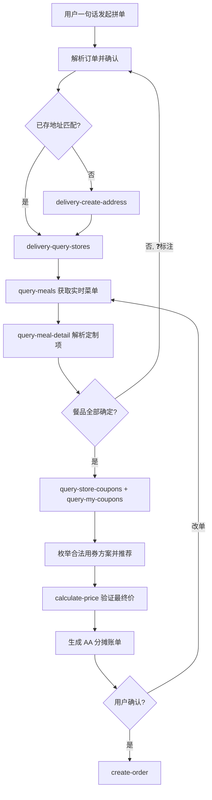

# MCP 集成说明

## MCP Server 信息

| 项 | 值 |
|---|---|
| 名称 | mcd-mcp |
| 协议 | MCP over Streamable HTTP |
| Endpoint | `https://mcp.mcd.cn` |
| 鉴权 | HTTP Header `Authorization: Bearer <TOKEN>` |
| 配置示例 | 见 `mcp-config.example.json` |

## 工具清单

| 工具名 | 调用时机 | 业务价值 |
|---|---|---|
| `delivery-query-addresses` | 外送流程起点，查询用户已存收货地址 | 复用既有地址，免重复录入 |
| `delivery-create-address` | 已存地址不匹配时，创建新收货地址 | 补齐外送下单前置条件 |
| `delivery-query-stores` | 选定地址后，查询可配送门店（返回 storeCode + beCode） | 锁定履约门店，后续所有调用的入参来源 |
| `query-nearby-stores` | 到店自取/得来速场景查门店 | 覆盖非外送场景 |
| `query-meals` | 获取该门店实时菜单与价格 | 价格实时权威，杜绝凭印象报价 |
| `query-meal-detail` | 查套餐组成、特制选项（换饮料/去糖/加冰等） | 支撑「可乐换无糖」等定制需求，拿到算价所需的 modification key |
| `query-store-coupons` | 查询「本门店+本订单类型」实际可用的券 | 优惠决策的唯一可信来源 |
| `query-my-coupons` | 查询用户卡包全部券资产 | 补充可领取/已持有券视图 |
| `available-coupons` | 查询麦麦省当前可领取的券 | 发现未领取的潜在优惠 |
| `calculate-price` | 提交商品+券组合，返回含优惠的精确价格（单位：分） | 下单前的最终价格验证，AA 分摊的数据基础 |
| `create-order` | 用户确认账单后创建订单 | 闭环交易 |

## 调用流程（外送拼单）

## 实战经验（踩坑记录）

- 用券商品传入 `calculate-price` 时，`productCode` 必须使用**券面返回的商品编码**（如麦辣鸡腿堡券为 `1440`），而非菜单中的餐品编码（`901440`），否则返回 `600012 促销规则不支持该商品`。
- 含 `unselectedKey` 的特制组，组内所有特调项都必须传入算价接口：选中项用 `selectedKey`，未选中项用 `unselectedKey`。
- 所有价格字段单位为「分」，展示时除以 100。
